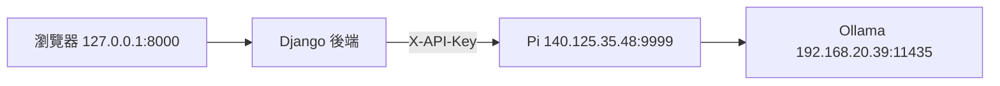

# Ollama Django Client Example

可直接啟動並修改的 Django 模型問答網站。網站在自己的電腦或 Raspberry Pi 執行，由後端呼叫既有的 Ollama 中介 API。預設服務位址為 **http://140.125.35.48:9999**。



網站提供模型選單、中文問答、表單驗證、錯誤提示，以及 API 呼叫時間、輸出 token、生成速度、伺服器總時間與模型載入時間。API_KEY 僅在後端使用；表單保留 CSRF，模型回答以文字呈現。

## 下載與啟動

請先安裝 Python **3.11–3.14**（建議 3.13），再選擇自己的平台說明。Django 固定為 `5.2.18`，套件安裝到專案 venv，不需要本機 GPU、Ollama、OpenAI 帳號或資料庫伺服器。Python 支援範圍依 [Django 5.2 文件](https://docs.djangoproject.com/en/5.2/faq/install/#what-python-version-can-i-use-with-django)。

| 平台 | 安裝、金鑰與啟動說明 |
|---|---|
| Windows PowerShell | [Windows 操作](docs/WINDOWS.md) |
| macOS（zsh／Bash） | [macOS 操作](docs/MACOS.md) |
| Raspberry Pi／Linux（Bash） | [Raspberry Pi 操作](docs/RASPBERRY_PI.md) |

各平台皆先下載專案：

```text
git clone https://github.com/minhuangyuntech/ollama-django-client-example.git
cd ollama-django-client-example
```

也可在 GitHub 按 **Code → Download ZIP**，解壓縮後進入含 `manage.py` 的資料夾。ZIP 資料夾可能名為 `ollama-django-client-example-main`。

啟動步驟一致：建立 venv → 安裝 requirements → 在終端機設定 API_KEY → 執行 `check_gateway` → 啟動 `runserver` → 瀏覽器開啟 **http://127.0.0.1:8000/**。完整指令在各平台頁面，無需修改程式中的金鑰。

## 網路與認證

API_KEY 是中介服務提供的金鑰，並非每個網站自行生成。預設中介限制來源網段 `140.125.0.0/16`；判斷對象是 **Django 主機的實際連線來源**，不是瀏覽器所在位置。Django 在其他網段時需有合適的校內網路、路由或 VPN 設定。

環境變數由啟動的程序繼承。新開終端機需重新設定；更新金鑰後要重啟 Django。此專案不會自動讀取 `.env` 檔；所有操作說明都使用終端機環境設定。實際金鑰不加入 Git、HTML、JavaScript、URL 或作業附件。

中介 API 的根路徑 `/` 未開放。就緒檢查使用 `/readyz`，模型清單使用 `/api/tags`；這與瀏覽器開啟自己 Django 的根路徑 `/` 不同。

## 程式結構

| 檔案 | 功能 |
|---|---|
| `course_site/settings.py` | 讀取 API 位址、金鑰與網站設定 |
| `course_site/urls.py`、`chat/urls.py` | 將網站路徑連到 view |
| `chat/forms.py` | 模型選項、問題長度與必填驗證 |
| `chat/gateway.py` | HTTP、UTF-8 JSON、認證、逾時及錯誤處理 |
| `chat/views.py` | 協調表單、API 與頁面資料 |
| `chat/templates/chat/index.html` | 模型選單、問答、錯誤與量測 |
| `chat/static/chat/style.css` | 電腦與手機版面 |
| `chat/management/commands/check_gateway.py` | 檢查中介服務及模型清單，金鑰不輸出 |
| `chat/tests.py` | mock 測試，不需真實 API_KEY 或模型服務 |

目前每次提問獨立處理，以 `stream:false` 取得完整 JSON。沒有資料庫模型，不需要 `migrate`。[程式串接說明](docs/PROGRAMMING.md)與[修改練習](docs/EXERCISES.md)可用於閱讀、設計及擴充網站。

## 設定項目

| 環境變數 | 預設／用途 |
|---|---|
| `API_KEY` | 必須設定，沿用中介服務金鑰 |
| `OLLAMA_GATEWAY_URL` | `http://140.125.35.48:9999`，不加 `/readyz` 或 `/api/chat` |
| `DJANGO_ALLOWED_HOSTS` | `127.0.0.1,localhost`；以逗號分隔主機名稱或 IP，不包含協定與埠 |
| `DJANGO_DEBUG` | `1`，本機開發模式 |
| `DJANGO_SECRET_KEY` | 未設定時為程序生成隨機值；與 API_KEY 不同用途 |

`runserver` 用於練習與開發，不是正式公開網站的部署方式。[Django runserver 文件](https://docs.djangoproject.com/en/5.2/ref/django-admin/#runserver)

## 檢查與排錯

```text
python manage.py check
python manage.py check_gateway
python manage.py test chat
```

以上 `python` 指 venv 裡的執行器；Windows 使用 `.\.venv\Scripts\python.exe`，Pi／macOS 使用 `.venv/bin/python`。

`check_gateway` 依序檢查 `/healthz`、`/readyz`、`/api/tags`，不進行模型推論。就緒成功仍需在網站完成一次實際問答，才能驗證模型生成。

| 狀況 | 檢查方式 |
|---|---|
| 尚未設定 API_KEY | 在啟動網站的同一個終端機設定，重啟 Django |
| API 401 | 確認 key、空白或多餘引號；輪替後重新設定 |
| API 403 | 檢查 Django 主機來源網段；與表單的 CSRF 403 分開判斷 |
| CSRF 403 | 保留 middleware／token，重新開啟同一網站表單 |
| 404 或「未開放此 API 路徑」 | API 檢查用 `/readyz`；Base URL 僅填協定、主機與埠 |
| 429 | 全體共用的同時請求名額已滿，稍候再試 |
| 502／503／504 | 上游連線、模型就緒或生成逾時，保留錯誤訊息 |
| DisallowedHost | 核對 `DJANGO_ALLOWED_HOSTS` 或改用 localhost／SSH 轉送 |
| 8000 埠已使用 | 關閉另一個開發網站，或改用 `127.0.0.1:8001` |

隔離測試使用明確標記的測試金鑰及 mock 回應，不呼叫校內 AI 服務。GitHub Actions 會在 Windows、macOS 與 Linux 執行相同檢查；Linux CI 不等同 Raspberry Pi ARM 實機驗收。

中介服務程式：[minhuangyuntech/ollama-api-gateway](https://github.com/minhuangyuntech/ollama-api-gateway)。
